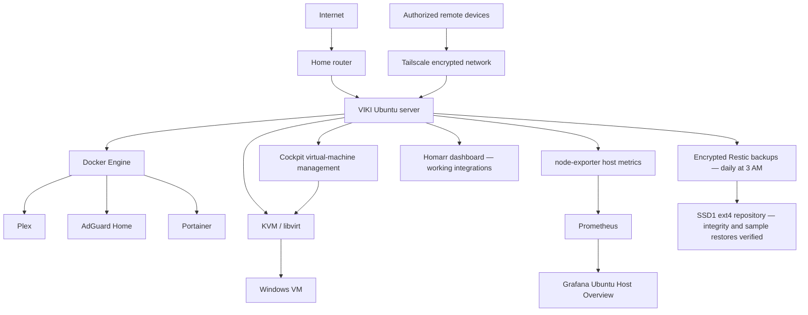

# VIKI — Secure Ubuntu Homelab


I built VIKI, my 24/7 Ubuntu homelab, to develop practical skills in Linux
administration, Docker, network security, automation, secure remote access,
and recovery planning. This repository documents my progress and what I'm
learning along the way.

> I use example addresses and sanitized configuration in my public notes.
> I keep credentials, tokens, private addresses, device identifiers, claim codes,
> and personal data out of this repository.

## My current architecture



## Services I've installed

| Service | Purpose | Primary control |
| --- | --- | --- |
| Ubuntu | Bare-metal server platform | Regular patching and least privilege |
| Docker | Isolated application deployment | Persistent volumes and controlled ports |
| Plex | Personal media management | Authenticated access and restricted storage mounts |
| AdGuard Home | Network DNS filtering | Local network exposure and controlled administration |
| Portainer | Container administration | Strong authentication and private access |
| Tailscale | Remote administration | Identity-based encrypted connectivity |
| KVM / libvirt | Windows VM virtualization | VM lifecycle managed on Ubuntu |
| Cockpit / cockpit-machines | Browser-based VM management | Authenticated administrative access |
| node-exporter | Ubuntu host metrics | Host CPU, memory, filesystem, network, and uptime telemetry |
| Prometheus | Metrics collection and querying | Scrapes node-exporter for host monitoring |
| Grafana | Host monitoring dashboards | Working Ubuntu Host Overview dashboard |
| Homarr | Central service dashboard | Working dashboard access and confirmed integrations |
| Wazuh | SIEM and endpoint telemetry | Deployed for security monitoring |
| OPNsense | Virtualized firewall and routing | Installed; routing and isolation testing in progress |
| Wireshark | Packet capture and analysis | Installed; initial packet inspection practice completed |

## My security decisions

- I reach my administrative services through Tailscale instead of opening
  arbitrary public ports.
- I store application data in persistent Docker volumes or explicit bind
  mounts so containers can be recreated safely.
- I keep backup media on a different physical device from the Ubuntu system
  disk.
- I build destructive automation with preview and confirmation controls.
- I keep secrets out of Git with `.gitignore` and manual review.
- I plan to run malware-analysis workloads in isolated virtual machines with
  no trusted LAN access.

## My projects

### 1. Containerized service deployment

I've deployed and maintained multiple services with Docker, persistent storage,
restart policies, and purpose-specific network exposure.

### 2. Secure remote administration

I configured Tailscale so my approved devices can administer the server without
exposing SSH and management dashboards directly to the internet.

### 3. DNS filtering

I deployed AdGuard Home as a network DNS service and verified that client DNS
traffic reached the filtering server.

### 4. Gmail API automation

I developed a Python workflow using OAuth 2.0 and the Gmail API. The program
paginates through message results, categorizes unread mail by age, previews the
impact, and performs batched label modifications.

### 5. Windows virtualization with KVM and Cockpit

I installed KVM/libvirt and Cockpit with the virtual-machines extension on the
Ubuntu host, then created a Windows VM. This lets me keep my Docker services running while using a separate Windows
learning environment. I still need to document the VM's network isolation
and guest configuration.

### 6. CPU clock troubleshooting and BIOS recovery

I investigated why my Intel Core Ultra 5 250K Plus was stuck near 400 MHz even under
load. I checked temperatures and CPU telemetry, then updated the Gigabyte
B860 DS3H WIFI6E rev. 1.0 BIOS with Q-Flash. When I repeated the load test, I measured
approximately 4.6–5.1 GHz at 100% busy. See
[the troubleshooting record](docs/cpu-bios-troubleshooting.md) for evidence
and steps.

### 7. Migration backup planning

I created a Bash workflow that inventories the system, pauses containers for a
consistent data snapshot, backs up volumes and bind mounts, restarts services,
copies media, and generates SHA-256 checksums.

### 8. Ubuntu host monitoring with Grafana and Prometheus

I deployed Grafana, Prometheus, and node-exporter through Docker and brought the
Ubuntu Host Overview dashboard online. The dashboard displays CPU usage,
memory, filesystem usage, network traffic, uptime, load, and exporter health.
I troubleshot initially blank dashboard panels until my host metrics displayed.

I've completed my initial host monitoring milestone. I still need to add
service availability probes, verify alert delivery, centralize logs, and
document a simulated security incident. See the
[monitoring and log-detection project](docs/grafana-monitoring-detection.md).

### 9. Working Homarr dashboard and integrations

I installed Homarr as a central dashboard for navigating my homelab's services.
I confirmed dashboard access, service links, and integrations were working on
October 5, 2026. I keep credentials and credential files out of my public notes.

### 10. Verified encrypted daily SSD backups

I moved my unfinished phone backup setup to SSD1. Before erasing the destination
partition, I identified the physical disk, checked dependencies and capacity,
confirmed the erase, and completed an extended SMART test. The
existing main partition now uses ext4 and mounts at /mnt/viki-backup by UUID.
The existing systemd service and timer run daily at 03:00 America/Chicago.

My initial encrypted repository used approximately 32 GiB, leaving about
184 GiB available. I've configured retention to keep 7 daily, 4 weekly, and 2 monthly snapshots
per backup group. I ran integrity checks across all repository data, and seven representative
restores matched their recorded hashes. I also tested what happens when the
backup disk is missing: the jobs refuse to write to the wrong destination.

My backups cover application configuration, Compose files, persistent app
data, Home Assistant, personal files, and Windows VM storage and definitions.
I capture databases while applications are stopped and also create an Immich
PostgreSQL logical dump. I copy VM disks only while the VM is shut down.
I've excluded the failing second drive. SSD1 passed its extended test but
retains historical errors, so independent backup coverage remains important.

I retired server-side phone-transfer access after verifying the SSD backups.
I still need to confirm that the phone-side schedule is removed. I'm keeping
previous backups in case they contain unique older files. This is local file/application backup,
not a bare-metal image or a complete 3-2-1 setup. I still need to test full application recovery, boot a restored VM, and check
the first unattended SSD run.

See [the backup and recovery record](docs/viki-backup-recovery.md) for scope,
exclusions, restore instructions, and remaining work.

### 11. VLAN segmentation and managed switching — in progress

I installed a NETGEAR GS308E managed switch and OPNsense in my Ubuntu/KVM
lab. I'm working toward separate VLANs for VIKI services, an AP/wireless lab,
and malware-learning exercises. I'm still configuring internet routing through
OPNsense and testing firewall isolation.

I've documented what I've learned about switching, broadcast domains, access
ports, trunks, PVIDs, and how OPNsense controls routed traffic. I also installed
Wireshark and began inspecting packets I captured while browsing.

See [the VLAN and switching progress record](docs/vlan-switching-progress.md)
for current status, intended policy, and pending validation.

## What I've learned

- I can recreate containers safely only when I've preserved important state
  outside the disposable container layer.
- I need to verify backup contents and checksums before trusting a backup.
- I need to plan DNS addressing carefully because clients depend on its
  availability.
- I've found private overlay networking useful for remote administration
  while reducing public exposure.
- I build automation that can delete data with safe defaults and an explicit
  execution boundary.
- I learned to check actual CPU frequency under load before blaming a slow UI
  on software, and to compare measurements before and after firmware changes.

## My roadmap

- [x] Install the managed switch and begin VLAN/switching practice
- [x] Install OPNsense in the Ubuntu/KVM lab
- [x] Install Wireshark and begin packet inspection
- [ ] Complete and document VIKI, AP, and malware-lab VLAN configuration
- [ ] Verify internet routing through OPNsense and test permitted/denied traffic

- [x] Complete an encrypted server backup and enable the daily systemd timer
- [x] Configure and validate the Windows QEMU guest agent
- [x] Diagnose the failing legacy HDD and exclude it from routine backups
- [x] Migrate the backup destination to SSD1 with an explicit disk erase confirmation
- [x] Verify full repository integrity and seven representative file restores
- [x] Validate missing-disk refusal and configure retention with pruning previews
- [x] Retire server-side phone-transfer access after SSD verification
- [ ] Observe the first unattended SSD backup and confirm phone-side schedule removal
- [ ] Preserve the password independently and review old phone backups for unique files
- [ ] Test full application recovery and a restored VM boot
- [ ] Monitor SSD1 health and establish another healthy independent backup
- [ ] Add a 1 TB NVMe as a parallel local backup destination
- [ ] Add an encrypted VIKI offsite copy in iCloud and verify restoration

- [x] Install Homarr for a central homelab dashboard
- [x] Verify Homarr login and organize service links
- [x] Configure and validate Homarr integrations

- [x] Add a UPS for backup power
- [ ] Configure and test automatic graceful shutdown on UPS battery power
- [ ] Configure automated security updates and alerting
- [x] Deploy Prometheus, node-exporter, and Grafana with a working Ubuntu host dashboard
- [ ] Extend monitoring to DNS/app availability and validate alert delivery ([project guide](docs/grafana-monitoring-detection.md))
- [ ] Add centralized logs and validate an SSH-failure detection exercise
- [ ] Configure automatic VM snapshot rotation
- [x] Create a Windows VM with KVM and Cockpit
- [ ] Document Windows VM networking and verify isolation before risky testing
- [x] Add Wazuh for endpoint telemetry
- [ ] Create detection rules and document a simulated incident
- [ ] Test a full restore onto a clean virtual machine

## Repository map

```text
.
├── README.md
├── SECURITY.md
├── docs
│   ├── vlan-switching-progress.md
│   ├── architecture.md
│   ├── viki-backup-recovery.md
│   ├── cpu-bios-troubleshooting.md
│   ├── grafana-monitoring-detection.md
│   └── portfolio-talking-points.md
└── .gitignore
```

## Ethics

I use this environment only with systems and accounts I own or have explicit
permission to test. I design my security experiments to stay isolated from
third-party systems and production networks.

